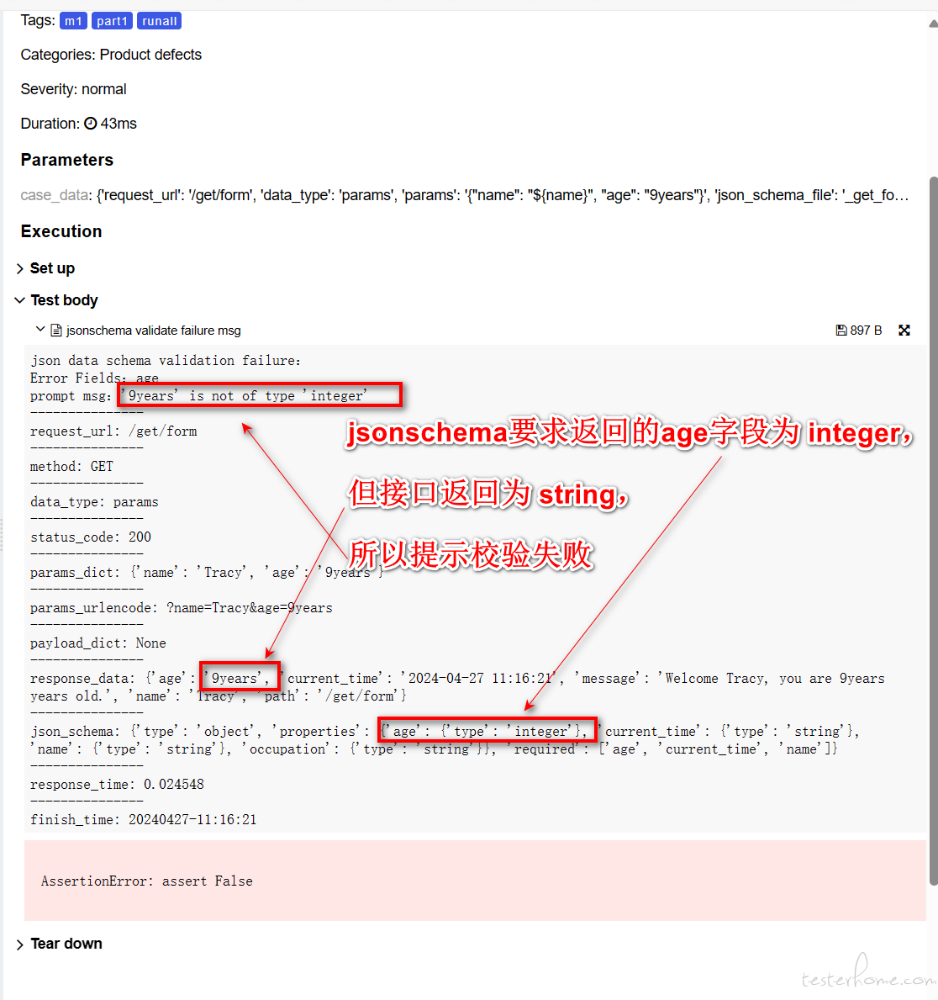

## Python 3 实现 Http API 自动化(pytest + requests + Allure)

---
### 主要思路和步骤
1. 借助Mitmproxy来抓取产品使用中的http api接口数据( [record_http_apis.py](./Assist-Tools/record_HTTP_API_via_mitmproxy/record_http_apis.py) )
2. 运行 [generate_newcases_from_api_record.py](./Assist-Tools/generate_newcase_from_apirecord_csv/generate_newcases_from_api_record.py) 处理抓取到的接口数据，生成新api的测试数据。
3. 根据需要设置api的测试数据，补充到框架中。如完善status code, 指定运行环境和优先级，提取参数变量等。
4. 执行新增api的测试。  
---
### 实现功能
- 通过requests session会话，一次登录，免除cookie关联处理
- 测试数据驱动，csv方便版本比较，补充完善用例
- 自动生成测试用例（含断言），小白也很好用
- 支持接口间传参
- 支持多进程，加速测试执行过程
- 支持多环境切换，仅需改动一处
- 断言：除了status code，还支持json schema断言
- 漂亮的Allure报告，可查看每个接口的请求和响应数据，以及断言，方便排查
- Slack告警（老东家用的，这里已去除）
- ......

---
## 整体结构
- ### Assist-Tools/
- [flask_http_methods_demo](Assist-Tools/flask_http_server_demo) 是一个简单的Flask项目，在本地创建一些http接口，方便用于测试本框架。执行命令 `python app.py` 即可在本地启动一个http服务器，默认监听5000端口。
- [record_HTTP_API_via_mitmproxy](Assist-Tools/record_HTTP_API_via_mitmproxy)  启动`mitmproxy`监听一个端口，可抓取产品使用中的http api接口数据并存到csv文件中，例如 [apirecord_demo.csv](./Assist-Tools/record_HTTP_API_via_mitmproxy/apirecord_dir/apirecode_demo.csv) 
- [generate_newcase_from_apirecord_csv](Assist-Tools/generate_newcase_from_apirecord_csv) 处理`mitmproxy`抓取的api数据文件，生成新api的测试数据"*_cases.csv"，例如 [apirecode_demo_cases.csv](./Assist-Tools/generate_newcase_from_apirecord_csv/apirecode_demo_cases.csv)

- ### bases
- [app_apibase.py](bases/app_apibase.py)：核心类，包括登录、发送 http 请求（get、post...）以及以 json 格式返回数据
  注：登录接口请求后，通常需要往`headers`增加字段，请根据实际情况完善`login_session`函数结尾已注释部分。  
- [jsonschema_handle.py](bases/jsonschema_handle.py) 主要功能有两个：
- 1. 读取 .json 文件并返回 JSON Schema。
- 2. 验证 JSON Schema 并将结果添加到 Allure 报告中。

- ### cases
- 通过```pytest```框架管理测试用例，建议按功能模块分区。已覆盖功能范围：
- [x] feature A Demo API
- [x] feature B Demo API

- ### config
- [base_config.py](config/base_config.py)：读取 'config.yaml' 文件以获取 base_url、username和password，...
- [config.yaml](config/config.yaml): 填写测试环境，base_url, 账号、密码，要执行的case优先级等信息。
对于 `case_pytest_lst` 里每项实际是pytest的参数，如`-n`表示pytest-xdist多进程。

- ### logs
- 保存脚本生成的日志
- http接口请求数据记录（csv格式）

- ### report
- 保存 Allure 生成的测试报告（实际目录为 `report/`）

### utils
- [csv_parse.py](utils/csv_parse.py)：将.csv转换为测试用例
- [handle_request.py](utils/handle_request.py)：处理每个测试用例的 request_url、params、payload, 发送http请求
- [common_funs.py](utils/common_funs.py)：一些常用函数
- [report_post_handle.py](utils/report_post_handle.py)：用例执行完毕后，分析统计生成的Allure记录数据，形成报告。
  还可以从请求csv记录中筛选出状态码不是200，以及响应时间超过3秒的数据，生成html文件，方便查看。
- [write_csv.py](utils/write_csv.py)：辅助模块，记录 Http API 请求数据到 .csv 文件  
---
### 用法
1. 安装 Python 3.7+
2. 下载代码。
3. 在当前文件夹中，运行 `pip install -r requirement.txt` 安装依赖包
4. 通过[“allure2”](https://github.com/allure-framework/allure2)安装 allure 2.1.38+
5. 参考“config”子文件夹中的`config_sample.yaml`生成`config.yaml`文件，并进行配置。 
6. 如果是想体验下效果，可先进入 [flask demo](Assist-Tools/flask_http_server_demo) 目录，执行 `python app.py` 命令在本地启动一个http测试服务端，否则请忽略。 
7. 执行 `python3 run_api_cases.py`，完成后默认会自动打开测试报告网页。 
   另外，可以通过位置参数或 `-run_env` 指定运行环境，例如 `python3 run_api_cases.py prod` 或 `python3 run_api_cases.py -run_env prod`（两者等价，都会被写入 `run_env` 环境变量后再加载 config）。

报告会展示每个case的请求和返回数据，如果失败会注明原因，如下图所示：


---
### FAQ
1. ***Q: 各功能模块的测试用例 `.csv` 文件和`jsonschema`文件是如何得到的？***  
  方法有两种：
   1. 手动方式(不推荐)。根据示例，手动填入新case的每个字段，包括request url, method, params, payload, status code等，同样`jsonschema`文件也要手动写这种验证选项。
   2. 自动方式(强烈推荐)。先用`mitmproxy`抓取产品使用过程中的数据，再用脚本自动生成新接口的测试用例 `.csv` 文件和 `jsonschema` 文件。
   

2. ***Q: 如何用`mitmproxy`自动抓取产品使用中的http api接口数据？***  
  启动 [record_http_apis.py](./Assist-Tools/record_HTTP_API_via_mitmproxy/record_http_apis.py) 监听一个端口，设置产品通过该代理访问，这样脚本可将产品使用过程中的http api请求数据自动记录到`csv`文件中，内容可参考示例文件 [api reocde demo](Assist-Tools\record_HTTP_API_via_mitmproxy\apirecord_dir\apirecode_demo.csv)  ，具体用法详情可参考 [这里](.\Assist-Tools\record_HTTP_API_via_mitmproxy\README.md)  


3. ***Q: 如何根据跟`mitmproxy`自动记录的数据，生成新的测试用例`csv`文件和`jsonschema`文件？***  
  将`mitmproxy`抓取得到的csv文件，放到 [generate_newcase_from_apirecord_csv](./Assist-Tools/generate_newcase_from_apirecord_csv/) 下， 运行 `python generate_newcases_from_api_record.py`，可得到新api的用例数据文件 `*_cases.csv`, 每行数据即是一个接口用例，其包括request url,method,params,payload,status code等，以及用于校验返回数据的`jsonschema`文件(验证返回json数据的结构和数据内容，如字段是否缺失，字段类型是否正确、字段值是否符合预期等)，这些新api的jsonschema文件在 `new_jsonschema_files_dir` 下，根据实际将其完善后放到 `cases/jsonfiles` 下。  


4. ***Q: 某些接口的响应状态码可能有多个，如`200`和`502`都符合预期，该如何处理？***  
  通常来说，响应状态码`status_code`字段的值为`200`，如果可以是多个，则可将该字段值改成`[200, 502]`，如 [测试用例csv demo](cases/01_feature_A/01_feature_a1.csv), 第15-16行。  


5. ***Q: 某些接口仅允许在特定环境，或某个测试账号才执行，该如何处理？***  
  如果某些接口只允许在指定的环境运行, 可修改`run_env`字段，其默认值为 `all`，表示在所有环境都运行。如果改成`prod`，则表示仅在`prod`环境才运行。  


6. ***Q: 某些接口仅允许某个测试账号才执行，该如何处理？***  
  如果某些接口只允许某个账号身份登录才运行，可修改`run_env`字段，其默认值为 `all`，表示所有用户都运行。如果改成`abcd@yourapp.info`，则表示仅测试账号为`abcd@yourapp.info`时才运行。  


7. ***Q: 如何提取响应数据为变量，供之后的接口用例所使调用？***  
  在测试过程中，经常遇到下一个接口`B`需要用到上一个接口`A`响应数据的情况，这个时候就涉及到参数的提取。
  本框架在csv用例数据中定义了字段 `var_extract` 来进行后置参数的提取，根据接口返回响应数据（暂仅支持JSON，若是text则需要进一步完善）提取参数，保存在变量中，可供之后的接口用例所使调用。字段 `var_extract` 可转为`dict`，其`key`为变量名，`v` 是`jsonpath`表达式。
  假设接口`A`的返回为
    ```json
    {"data": [{"name": "Lucy", "age": "10", "grade": 4}, 
              {"name": "John", "age": "12", "grade": 6}]
    }
    ```
    若`var_extract` 字段为 `{"name": "$..name", "age": "$..age"}`，则表示将接口返回的json中的第一个`name`字段值`Lucy`，存到变量`name`中，该模块之后的用例接口`B`可通过 `${name}` 来引用，`age`同理。关于jsonpath表达式，可自行查询该库的更多具体用法。
    如果还有其它需要，如要取返回的最后一个字段，或者某个返回字段值中的部分，可以在代码逻辑中进一步扩展。
    如 [测试用例csv示例文件](cases/01_feature_A/01_feature_a1.csv), 第2行的`var_extract`字段，就表示从该接口返回数据取第一个"name"字段，然后在第3行的`payload`中引用该字段。

8. ***Q: 接口依赖与 `vars_dct` 变量共享机制是怎样的？多进程与单独调试有哪些注意事项？***  
  > ⚠️ **重要规范：变量依赖机制与执行隔离说明**
  - **模块级生命周期与作用域**：`vars_dct` 是在**单个测试用例模块文件**级别共享的字典，用于在同一个 feature 模块的一系列接口调用之间传递动态参数（如 Token、ID 等）。
  - **用例前后依赖顺序**：CSV 中的接口按自上而下的顺序依次执行。若接口 B 依赖接口 A 提取的变量 `${var_name}`，则接口 A 必须位于接口 B 之前。若上游未提取成功，下游用例检测到未解析的占位符时会自动标记为 `SKIPPED`，避免产生错误假象。
  - **跨模块隔离**：不同测试文件之间变量相互独立，**不可跨文件共享变量**。若有跨模块通用的基础数据（如公用账号、管理员凭证），请统一在 `config.yaml` 中配置。
  - **多进程并发模式要求**：使用 `pytest-xdist` 多进程执行时，必须配置 `--dist=loadfile`（已在 `config.yaml` 默认配置中指定），确保同一个测试文件的所有用例分发至同一个 worker 进程内按序执行，防止因进程间内存隔离导致变量丢失。
  - **单独调试某条用例时的注意**：若使用 `pytest -k "case_name"` 单独执行某条依赖变量的下游接口，因为上游接口未运行，该用例会因缺少变量而自动 Skip。单独调试该接口时，可临时在 CSV 中填入固定参数值，或在模块的 `vars_dct` 中硬编码默认测试值。
   
